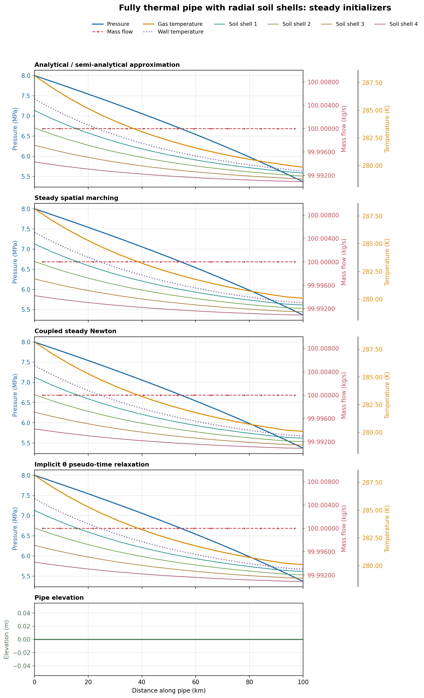

# Pipe Steady Initializers

Small C++20 reference implementation of four steady initializers for the isothermal single-pipe model:

1. Analytical pressure-squared profile with Swamee–Jain Darcy friction.
2. Physical pseudo-time relaxation of a staggered low-Mach pipe model under fixed boundary conditions.
3. Damped Newton solve of the same semi-discrete equations with all time derivatives set to zero.
4. Cell-by-cell discrete steady marching using the same semi-discrete momentum equation.

The current workspace did not contain the original `isothermal-pipe-sim` checkout, so this is a standalone implementation. Its spatial state and boundary storage now follow the simulator notes: pressure/density at $N+1$ nodes, $N$ internal mass flows at staggered faces, and half-cell control volumes at both pipe ends. The boundary conditions are fixed inlet pressure and prescribed outlet mass flow. The default demonstration uses the standard 100 km, 100-cell, 0.6 m pipe at 8 MPa inlet pressure and 100 kg/s outlet flow. The reference case is flat (`hill_height = 0`); nonzero hill elevations remain configurable.

## Model implemented

For constant pipe area $A=\pi D^2/4$, fixed uniform temperature $T_0$, and constant compressibility factor $Z$,

$$
C=Z R_s T_0,\qquad \rho=\frac{p}{C},\qquad u=\frac{\dot m}{A\rho}.
$$

The code uses the low-Mach isothermal pipeline equations

$$
\frac{\partial(A\rho)}{\partial t}
+\frac{\partial\dot m}{\partial z}=0,
$$

$$
\frac{\partial\dot m}{\partial t}
+A\frac{\partial p}{\partial z}
=-A\rho g\frac{dh}{dz}
-A\frac{f_D}{2D}\rho u|u|.
$$

The convective momentum-flux term is omitted, consistent with the pressure-squared analytical initializer. This is the conventional low-Mach reduction; it is an explicit model choice and should be matched to the target solver before integration.

At steady state, continuity makes the flow constant on every internal face. The inlet half-cell balance gives the inlet flow as the first internal flow, while the outlet half-cell balance enforces the prescribed outlet flow. The discrete linepack uses trapezoidal endpoint weights, $A\,dx\,[\rho_0/2+\sum_{i=1}^{N-1}\rho_i+\rho_N/2]$, matching the simulator's nodal storage convention.

The analytical method follows from the steady equations and constant mass flow. With $y=p^2$,

$$
\frac{dy}{dz}+\frac{2g}{C}\frac{dh}{dz}y
=-\frac{f_D C\dot m|\dot m|}{D A^2}.
$$

On flat pipe this reduces to the familiar linear pressure-squared relation. For the hill, the code advances the exact integrating-factor solution over each linearly interpolated elevation segment.

## Build and run

```sh
cmake -S . -B build -DCMAKE_BUILD_TYPE=Release
cmake --build build -j
ctest --test-dir build --output-on-failure
./build/pipe_init_demo
./build/pipe_init_benchmark 30 3 > initializer_timing_data.csv
python3 scripts/report_initializer_timings.py initializer_timing_data.csv
```

The benchmark warms each method, then records per-run wall time in CSV. The
analytical, discrete marching, and direct Newton methods use 30 repetitions by default; pseudo-time
relaxation uses 3 because it is substantially more expensive. Newton starts
from uniform inlet pressure and the prescribed flow, without an analytical
profile seed. Arguments override the two repetition counts, respectively.
The reporting script writes a Markdown summary with medians, ranges,
variability, work counts, residuals, and timing ratios relative to the fastest
median.

## Method behavior

- **Analytical:** fast continuum approximation; includes gravity and Swamee–Jain friction. It generally has a small mesh-dependent residual when checked against the discrete equations.
- **Discrete marching:** starts at the prescribed inlet pressure and solves the discrete momentum residual for each next pressure node, with the prescribed steady flow on every staggered face. It takes O(N) work, needs no global nonlinear solve, and reaches the same discrete steady profile as Newton for this model. It reports an error if a cell has no admissible positive-pressure root.
- **Relaxation:** initializes a uniform pressure and the prescribed outlet flow, then advances the staggered system with the simulator's implicit theta method. Each pseudo-time step solves the nonlinear theta-weighted continuity and momentum residuals with a damped Newton iteration. The default is $\theta=0.5$ (trapezoidal); set `RelaxationOptions::theta` to 1.0 for backward Euler. The pseudo-time step is `pseudo_courant * dx / sqrt(Z R_s T)`; this Courant-like factor controls convergence speed, not explicit-method stability.
- **Newton:** solves the finite-dimensional steady residual for the unknown nodal pressures $p_1,\ldots,p_N$ and staggered flows. The inlet pressure is fixed; a damped line search preserves positive pressures.

Discrete marching and steady Newton are equivalent for the current boundary conditions and constant friction factor closure; Newton remains useful as a general nonlinear-system reference. Theta relaxation should converge to the same equilibrium within its stopping tolerance. The analytical method provides a fast continuum approximation and an independent flat-pipe/hydrostatic reference.

## Adiabatic ideal-gas initializer experiment

The separate `pipe_init::adiabatic` module implements three initializer strategies for a calorically perfect ideal gas. It uses constant area, constant viscosity, Swamee–Jain Darcy friction, elevation, forward flow, prescribed inlet pressure and temperature, and prescribed outlet mass flow. The gas has constant $R_s$ and $\gamma$; there is no wall heat transfer, soil state, or real-gas EOS.

The steady cell momentum residual includes pressure, convective momentum flux, gravity, and Darcy drag. The steady energy balance conserves $h+u^2/2+gz$ between nodes. Spatial marching solves the local momentum and total-enthalpy equations cell by cell. Coupled Newton solves all continuity, momentum, and energy residuals together.

The adiabatic theta method advances the semidiscrete mass, momentum, and total-energy equations in pseudo-time under the steady boundary conditions. Pseudo-time is used only to reach the equilibrium; it is not presented as a physical transient run. The default demo uses $\theta=0.9$ for added damping of the pseudo-time iterations.

Build and run the adiabatic comparison:

```sh
cmake --build build --target adiabatic_pipe_init_demo -j
./build/adiabatic_pipe_init_demo
```

Export and plot all three adiabatic initializer profiles, with pressure, mass
flow, and temperature in the first three panels and pipe elevation in the
bottom panel:

```bash
cmake --build build --target adiabatic_pipe_init_profile_export -j
./build/adiabatic_pipe_init_profile_export > adiabatic_profiles.csv
python3 scripts/plot_adiabatic_profiles.py adiabatic_profiles.csv \\
    -o adiabatic_initializer_profiles.png
```

## Thermal gas and lumped-wall initializers

The thermal_wall module adds gas pressure, gas temperature, wall temperature,
and staggered mass flow. The wall is locally lumped through its thickness,
with no axial conduction. Soil temperature is prescribed. The demonstration
uses an ideal gas, constant heat capacities, Swamee–Jain friction, and the
simulator-aligned nodal/staggered layout. At steady state the wall balance is
algebraic, so wall temperature is recovered locally; wall heat capacity
remains active in pseudo-time relaxation.

The analytical approximation uses an exponential gas-temperature profile
and a continuous pressure integral. Spatial marching solves the discrete
temperature/wall balance and local momentum equation. Coupled Newton solves
the complete discrete steady residual; implicit theta relaxation advances
the semidiscrete gas/wall transient to equilibrium.

    cmake --build build --target thermal_wall_init_demo thermal_wall_profile_export -j
    ./build/thermal_wall_init_demo
    ./build/thermal_wall_profile_export > thermal_wall_profiles.csv
    python3 scripts/plot_thermal_wall_profiles.py thermal_wall_profiles.csv \
        -o thermal_wall_initializer_profiles.png

## Current scope

The implementation uses a constant-$Z$, constant-viscosity isothermal closure and Swamee–Jain friction. It implements forward flow for the demonstration configuration. The friction term itself is signed for reversed flow, but reversed-flow boundary handling is not yet generalized. The grid positions, endpoint half-cell storage, and boundary convention are aligned to the simulator notes. The momentum closure remains the reduced low-Mach form documented above; the original simulator's momentum flux, EOS, friction routine, and software interfaces still need direct comparison in its source checkout before claiming full physics or code-level equivalence.

## Fully thermal gas, wall, and soil-shell initializers

The `pipe_init::soil_shell` model extends the locally lumped pipe wall with
concentric radial soil shells. Each axial node has one temperature per soil
shell. Heat conducts radially between the wall and shells and through the
outermost shell to a prescribed far-field temperature. Soil has heat capacity
in pseudo-time; this reference model omits axial soil conduction. The gas uses
the same low-Mach ideal-gas momentum and energy balances, elevation, and
simulator-aligned staggered grid as the other thermal reference modules.

The default configuration has four soil shells, with node radii 0.40, 0.58,
0.84, and 1.20 m, and a prescribed far-field boundary at 2.0 m. The analytical
approximation treats the complete radial resistance as an effective heat
transfer coefficient and uses an exponential gas-temperature profile plus a
continuous pressure integral. Spatial marching solves the discrete energy
balance and local momentum equation, reconstructing wall and shell temperatures
from the radial resistance network. Coupled Newton solves every gas, wall, and
soil-shell steady balance simultaneously. Implicit theta relaxation advances
the same semidiscrete gas/wall/soil equations in pseudo-time. It starts close
to the analytical profile with a 5% perturbation in the soil-shell temperature
departure from far-field, then checks the common steady residual.

The demo reports one measured run time per initializer, scaled residual,
Newton/relaxation work counts, and scaled differences against spatial marching.
Its timing numbers are for comparison on the current run and are not statistical
benchmarks. Export and make the four-method plot, with one pressure/flow/
temperature panel per initializer and elevation below:

```sh
mkdir -p results
cmake --build build --target soil_shell_init_demo soil_shell_profile_export -j
./build/soil_shell_init_demo
./build/soil_shell_profile_export > results/soil_shell_profiles.csv
python3 scripts/plot_soil_shell_profiles.py results/soil_shell_profiles.csv \
    -o results/soil_shell_initializer_profiles.png
```

### Problem addressed and model scope

These initializers produce a pipe state consistent with fixed operating
boundary conditions before a transient simulation begins. A poor initial
state can create a long startup transient that reflects the initial mismatch
instead of the event being studied. The fully thermal case includes the gas,
pipe wall, and soil temperature states.

The reference model has pressure and gas temperature at the $N+1$ axial nodes,
mass flow at the $N$ staggered interior faces, one locally lumped wall
temperature at each node, and four concentric soil-shell temperatures at each
node. It uses constant gas properties and Darcy friction, elevation, fixed
inlet pressure and temperature, and prescribed outlet mass flow. Heat conducts
radially from gas to wall, between soil shells, and from the outer shell to a
fixed far-field temperature. The soil has thermal capacity during
pseudo-time relaxation, but axial soil conduction is omitted. Default
elevation is flat. The default nonlinear state has 133 unknowns.

### Initializer methods

| Method | Construction | Main tradeoff |
|---|---|---|
| Analytical / semi-analytical approximation | Collapses the wall and radial soil resistances into an effective conductance, uses an exponential gas-temperature profile, then integrates the continuous pressure equation. | Fast initial guess. It approximates the discrete balances, so its discrete residual is larger. |
| Steady spatial marching | Advances gas temperature cell by cell using the discrete energy balance, solves each cell's discrete momentum equation for pressure, and reconstructs wall and shell temperatures from radial resistance. | Linear work in the number of axial cells; satisfies the current model's discrete steady equations directly. |
| Coupled steady Newton | Solves the complete steady residual for nodal pressure, gas temperature, staggered flow, wall temperature, and every soil-shell temperature at once. The demo seeds it with the analytical approximation. | General nonlinear reference with a tight residual; more expensive than marching for this one-way, forward-flow pipe. |
| Implicit $\theta$ pseudo-time relaxation | Advances the coupled transient gas, wall, and shell balances with the implicit theta method until the common steady residual meets tolerance. The default uses $\theta=1$ (backward Euler), starting near the analytical profile with a small shell-temperature perturbation. | Uses the transient equations and supports more complicated state coupling, but requires repeated nonlinear solves. Pseudo-time is a numerical path to equilibrium, not elapsed operating time. |

### Dell 7710 timing and residuals

These single-run measurements came from the default 16-cell case with Release
optimization. The benchmark/report scripts below repeat the solves and report
medians and variability; use those repeated results for machine-specific
comparisons.

| Method | Runtime | Scaled steady residual | Work |
|---|---:|---:|---|
| Analytical / semi-analytical | 22 μs | $3.63\times10^{-4}$ | direct profile evaluation |
| Steady spatial marching | 10 μs | $1.75\times10^{-15}$ | one forward pass over 16 cells |
| Coupled steady Newton | 2.80 ms | $2.03\times10^{-15}$ | 2 Newton iterations |
| Implicit $\theta$ pseudo-time relaxation | 100.18 ms | $1.13\times10^{-9}$ | 16 steps; 54 inner Newton iterations; $\theta=1$ |

Marching, Newton, and relaxation converge to the same discrete state: outlet
pressure is 5.366695 MPa and outlet gas temperature is 280.094429 K. The
analytical approximation gives 5.368596 MPa and 279.834063 K. Its larger
residual is expected because it solves a continuum approximation rather than
the discrete grid equations. The printed runtimes are single observations and
will vary with compiler, optimization flags, and machine load.

### Reading the profile plot

The figure has one panel per initializer and a shared distance axis. In each
of the four upper panels, blue is pressure on the left axis, red dashed is
staggered mass flow on the inner right axis, and the outer right axis shows gas
temperature, wall temperature, and all four soil-shell temperatures. Soil
shell 1 is adjacent to the pipe wall; the shell curves approach the fixed
far-field temperature toward the outer radius. The bottom panel shows pipe
elevation. With the default flat pipe it is a zero line; set `hill_height` in
the configuration to compare elevation effects.



### Repeated performance report

The benchmark times each initializer after a warmup. The analytical profile
used as the Newton initial guess is constructed before Newton timing, while
theta relaxation includes its own initialization. Defaults are 30 runs for
analytical, marching, and Newton; 3 runs for relaxation; and one warmup per
method. Arguments select the three counts in that order:

```sh
mkdir -p results
cmake --build build --target soil_shell_benchmark soil_shell_profile_export -j
./build/soil_shell_benchmark 30 5 1 > results/soil_shell_timing_data.csv
python3 scripts/report_soil_shell_timings.py results/soil_shell_timing_data.csv \
    -o results/soil_shell_timing_report.md
./build/soil_shell_profile_export > results/soil_shell_profiles.csv
python3 scripts/plot_soil_shell_profiles.py results/soil_shell_profiles.csv \
    -o results/soil_shell_initializer_profiles.png
```

The Markdown report summarizes median and mean runtime, standard deviation,
minimum and maximum, solver work counts, maximum residual, outlet values, and
timing ratios against the fastest median.

This is a reference implementation for the three initializer algorithms, not yet a patch to the original simulator. The pressure/flow locations and boundary storage follow the simulator notes available here. Before merging into that repository, compare the exact momentum residual, EOS, friction routine and derivatives, and solver interfaces against its source checkout.
